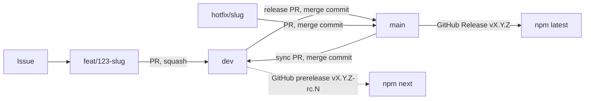

# Contributing to ds-dot

## Local development

Install dependencies, link your checkout into DeepSeek Harness, and run a watch build while developing:

```sh
pnpm install
dsh plugin --profile web add link:/path/to/ds-dot
pnpm watch
```

The linked checkout exposes `src`, and `pnpm watch` rebuilds `lib` as you edit. If pnpm asks for build permission when linking from source, allow `ds-dot` in that profile's `pnpm-workspace.yaml` and run `dsh plugin --profile web add link:/path/to/ds-dot` again.

Before pushing, run the same checks CI runs:

```sh
pnpm typecheck && pnpm test && pnpm build
```

## Branches and workflow

`dev` is the integration branch for ongoing work; `main` holds only published releases and hotfixes. Direct pushes to either branch are blocked by repository rulesets.



Feature and fix pull requests squash-merge into `dev` so the PR title becomes the single commit and release-notes line. Release (`dev` → `main`), hotfix (`hotfix/*` → `main`), and sync (`main` → `dev`) pull requests use merge commits so `main` and `dev` continue sharing history.

1. **Start from an issue.** Open or pick an issue and assign yourself so nobody duplicates the work (small typo or docs fixes can skip this).
2. **Branch from the latest `dev`** (using `feat/<issue>-<slug>`, `fix/<issue>-<slug>`, `refactor/...`, or `docs/...`):
   ```sh
   git switch dev && git pull
   git switch -c feat/123-short-name
   ```
   If `dev` moves on while you work, update with `git merge origin/dev` (or rebase and force-push your own branch only).
3. **Commit as you like** on your branch, then **open a pull request into `dev`**. GitHub preselects `main` (the default branch); change the base to `dev`.
   - Use a [Conventional Commits](https://www.conventionalcommits.org/) title (`feat(work): render English work orders`). Allowed types: `feat`, `fix`, `perf`, `refactor`, `docs`, `test`, `build`, `ci`, `chore`, `revert`, `release`. Add `!` for breaking changes (`feat(api)!: ...`).
   - Add `Closes #123` in the description so the issue closes when merged.
   - Keep PRs focused; prefer several small PRs to one large one.
4. **Pass checks and review.** `CI result` (typecheck, test, build, and pack on Linux and Windows) and `PR title` must pass, and all review threads must be resolved before squash-merging into `dev`.
5. **Squash and merge**, then delete the branch.

## Releases and hotfixes

See [docs/releasing.md](docs/releasing.md).
