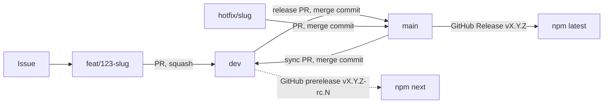

# Contributing to ds-dot

## Local development

Install dependencies, link your checkout into DeepSeek Harness, and run a watch build while developing:

```sh
pnpm install
dsh plugin --profile web add link:/path/to/ds-dot
pnpm watch
```

The linked checkout exposes `src`, and `pnpm watch` rebuilds `lib` as you edit. If `pnpm` prompts for build permission when linking from source, allow `ds-dot` in that profile's `pnpm-workspace.yaml` and rerun `dsh plugin --profile web add link:/path/to/ds-dot`.

Before pushing, run the full CI gate locally:

```sh
pnpm typecheck && pnpm test && pnpm build
```

## Branches and workflow

`dev` is the integration branch for ongoing work; `main` holds only published releases and hotfixes. Direct pushes to both branches are blocked by repository rulesets.



Feature and fix PRs squash-merge into `dev` so the PR title becomes the single commit and release-notes entry. Release (`dev` → `main`), hotfix (`hotfix/*` → `main`), and sync (`main` → `dev`) PRs use merge commits so `main` and `dev` continue sharing history.

1. **Start from an issue.** Open or claim an issue so work is not duplicated (trivial typo or docs fixes may skip this).
2. **Branch from the latest `dev`** (`feat/<issue>-<slug>`, `fix/<issue>-<slug>`, `refactor/...`, or `docs/...`):
   ```sh
   git switch dev && git pull
   git switch -c feat/123-short-name
   ```
   If `dev` advances while you work, sync with `git merge origin/dev` (or rebase your feature branch).
3. **Open a pull request targeting `dev`** (GitHub defaults to `main`, so switch the base branch to `dev`):
   - Use a [Conventional Commits](https://www.conventionalcommits.org/) PR title (`feat(work): render English work orders`). Allowed types: `feat`, `fix`, `perf`, `refactor`, `docs`, `test`, `build`, `ci`, `chore`, `revert`, `release` (append `!` for breaking changes, e.g. `feat(api)!: ...`).
   - Reference the issue with `Closes #123` in the PR body.
   - Keep PRs focused; prefer small, reviewable changes over monolithic diffs.
   - Include a live interaction GIF whenever the PR touches the frontend (see [Frontend changes](#frontend-changes)).
4. **Pass CI and review.** `CI result` (typecheck, test, build, and pack on Linux and Windows) and `PR title` must pass, all review threads must be resolved, and any required frontend GIF must be embedded in the PR body before squash-merging.
5. **Squash and merge**, then delete the feature branch.

## Frontend changes

A pull request counts as a frontend change whenever it alters what a user sees or interacts with in Dorothy's UI inside DeepSeek Harness — including client components (`src/**/*.tsx`, excluding `*.spec.tsx`), user-facing copy (`src/ui-copy.ts`, `src/i18n/locales/*.ts`, `locale/*.json`), and icons (`icon.svg` or inline SVG glyphs). Backend-only, test-only, and docs-only diffs do not count.

- **When a PR changes the frontend:** Embed a real interaction GIF in the PR body recorded from a live `dsh web` instance running your branch, and state the commit SHA recorded (e.g. `Recorded on commit <sha>`). Show the actual interaction and visual outcome on screen — static screenshots, mockups, synthetic animations, or text claims do not satisfy this requirement. Keep the GIF file off the Git branch.
- **How to record safely:** Use the bundled `dsh-web-acceptance` skill in `.agents/skills/dsh-web-acceptance/`, which launches an isolated `DSH_HOME` instance, exchanges the startup token for an `HttpOnly` cookie prior to recording, and exports a palette-optimized GIF outside the repository with zero API keys, `?token=` URLs, cookies, or personal data.
- **When a PR leaves the frontend untouched:** Write `No frontend changes` in the PR body. Do not use that marker on diffs that touch UI components, styles, icons, or user-facing copy, regardless of how small the change is.

Reviewers verify the PR body against the diff directly (CI does not validate GIF presence).

## Releases and hotfixes

See [docs/releasing.md](docs/releasing.md).
