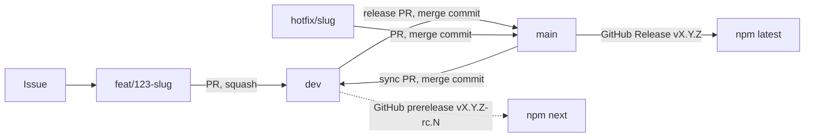

# Contributing to ds-dot

## Branches

| Branch | Purpose | Who writes to it |
|---|---|---|
| `main` | Exactly what is published on npm. Every commit here is a release or hotfix. | Release and hotfix pull requests only |
| `dev` | Integration branch. Always green, always releasable as a prerelease. | Pull requests only |
| `feat/<issue>-<slug>`, `fix/<issue>-<slug>`, `refactor/...`, `docs/...` | One piece of work, cut from `dev`. | You |
| `hotfix/<slug>` | Urgent fix for the published version, cut from `main`. | Maintainers |

Nobody pushes directly to `main` or `dev`; repository rulesets enforce this.



## Everyday work

1. **Start from an issue.** Open one (or pick one) and assign yourself so nobody
   duplicates the work. Small typo or docs fixes can skip this.
2. **Branch from the latest `dev`:**
   ```sh
   git switch dev && git pull
   git switch -c feat/123-short-name
   ```
3. **Commit as you like** on your branch; the PR is squashed, so only the PR
   title ends up in `dev`.
4. **Open a pull request into `dev`.**
   - Title in [Conventional Commits](https://www.conventionalcommits.org/) form:
     `feat(work): render English work orders`. Allowed types: `feat`, `fix`,
     `perf`, `refactor`, `docs`, `test`, `build`, `ci`, `chore`, `revert`,
     `release`. Add `!` for breaking changes: `feat(api)!: ...`.
   - Put `Closes #123` in the description so the issue closes on merge.
   - Keep it focused; prefer several small PRs to one large one.
5. **Pass checks and review.** `CI result` (typecheck, test, build and pack on
   Linux and Windows) and `PR title` must be green, and one reviewer must
   approve. Resolve all review threads.
6. **Squash and merge**, then delete the branch.

If `dev` moved on while you worked, update your branch with
`git merge origin/dev` (or rebase if you prefer, then force-push your own
branch only).

Run the same checks locally before pushing:

```sh
pnpm install
pnpm typecheck && pnpm test && pnpm build
```

## Merge methods at a glance

| Pull request | Method | Why |
|---|---|---|
| feature/fix → `dev` | **Squash** | One commit per PR, title becomes the release-notes line |
| `dev` → `main` (release) | **Merge commit** | Keeps `main` and `dev` sharing history |
| `hotfix/*` → `main` | **Merge commit** | Same |
| `main` → `dev` (sync) | **Merge commit** | Squashing here would leave `main` and `dev` permanently diverged |

## Releases and hotfixes

See [docs/releasing.md](docs/releasing.md).
