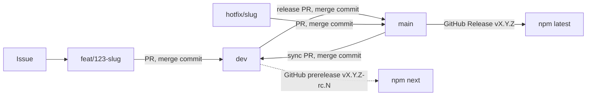

# Contributing to ds-dot

Thanks for helping make Dorothy (`ds-dot`) better! Whether you're fixing a typo, polishing docs, or building a new panel feature, this guide walks through how we develop, test, and land changes cleanly.

> [!TIP]
> **Quick PR checklist:** Branch from `dev` → run `pnpm typecheck && pnpm test && pnpm build` → sync GitHub Pages (`docs/`) and READMEs if adding/changing a user-facing feature → target `dev` with a [Conventional Commits](https://www.conventionalcommits.org/) PR title → attach a live `dsh web` GIF if users will see the change in the panel during normal use (or write `No frontend changes`).

---

## Local development

Install dependencies, link your local checkout into DeepSeek Harness, and keep a watch build running while you edit:

```sh
pnpm install
dsh plugin --profile web add link:/path/to/ds-dot
pnpm watch
```

The linked checkout exposes `src`, and `pnpm watch` rebuilds `lib` automatically on save. If `pnpm` asks for build approval when linking from source, allow `ds-dot` in that profile's `pnpm-workspace.yaml` and re-run `dsh plugin --profile web add link:/path/to/ds-dot`.

Before pushing, run the full local CI gate:

```sh
pnpm typecheck && pnpm test && pnpm build
```

`pnpm test` also runs the Arena builder's stdlib tests, which need Python 3.10+ on PATH as `python3` or `python` (duckdb is not required).

---

## Branches and workflow

`dev` is the integration branch for ongoing work; `main` holds only published releases and hotfixes. Direct pushes to both branches are blocked by repository rulesets.



Feature and fix PRs merge into `dev` with a **merge commit** so feature history stays intact; the merge commit subject is the PR title plus the PR number, which becomes the release-notes entry. Because your branch commits land on `dev` verbatim, feel free to tidy, squash, or rebase within your own feature branch before merging (unlike `main` ↔ `dev`, which must always share history via merge commits). Release (`dev` → `main`), hotfix (`hotfix/*` → `main`), and sync (`main` → `dev`) PRs also use merge commits.

1. **Start from an issue:** Open or claim an issue so work isn't duplicated (trivial typo or docs fixes can skip this).
2. **Branch from the latest `dev`:** Use `feat/<issue>-<slug>`, `fix/<issue>-<slug>`, `refactor/...`, or `docs/...`:
   ```sh
   git switch dev && git pull
   git switch -c feat/123-short-name
   ```
   If `dev` moves ahead while you're working, sync with `git merge origin/dev` (or rebase your feature branch).
3. **Open a PR targeting `dev`** (GitHub defaults to `main`, so switch the base branch to `dev`):
   - Format the PR title as a [Conventional Commit](https://www.conventionalcommits.org/) (e.g., `feat(work): render English work orders`). Allowed types: `feat`, `fix`, `perf`, `refactor`, `docs`, `test`, `build`, `ci`, `chore`, `revert`, `release` (append `!` for breaking changes, e.g., `feat(api)!: ...`).
   - Reference the issue with `Closes #123` in the PR description.
   - Keep PRs focused — small, reviewable changes beat monolithic diffs.
   - Include a live interaction GIF whenever users will see the change in the panel during normal use (see [Frontend changes](#frontend-changes)).
   - Sync the GitHub Pages showcase (`docs/`) and READMEs whenever your PR adds or changes a user-facing feature (see [GitHub Pages and documentation sync](#github-pages-and-documentation-sync)).
4. **Pass CI and review:** Both `CI result` (typecheck, test, build, and pack across Linux and Windows) and `PR title` must pass, all review threads must be resolved, any required frontend GIF must be in the PR body, and any user-facing feature must be synced to GitHub Pages before merging.
5. **Merge with a merge commit**, then delete the feature branch.

---

## Frontend changes

A PR counts as a **frontend change** when it changes what a user sees or does in Dorothy's panel in normal use: a layout, control, interaction, style, icon, or copy that a reviewer can reach in a live `dsh web` instance by using the panel. What counts is the visible result, not the files touched — a diff in `src/**/*.tsx` or the locale files that changes nothing on screen in normal use is not a frontend change.

Backend-only, test-only, and docs-only diffs (including `README.md`, `CONTRIBUTING.md`, and `docs/` pages) do **not** count.

> [!IMPORTANT]
> **If your PR changes the frontend:**
> - Embed a real interaction GIF in the PR body recorded from a live `dsh web` instance running your branch, and state the commit SHA recorded (e.g. `Recorded on commit <sha>`).
> - Show the actual interaction and on-screen outcome — static screenshots, mockups, synthetic animations, or written claims do not satisfy this rule. Keep the GIF file off the Git branch.
> - **Record safely with `dsh-web-acceptance`:** Use the bundled skill in [`.agents/skills/dsh-web-acceptance/`](.agents/skills/dsh-web-acceptance/), which launches an isolated `DSH_HOME` instance, exchanges the startup token for an `HttpOnly` cookie before recording, and writes a palette-optimized GIF outside the repo with zero API keys, `?token=` URLs, cookies, or personal data.

- **If the only visible change is a failure state:** Text or banners that appear only when something is broken — the backend is not loaded, the panel and backend versions differ, a host call fails — cannot be brought up on demand in a live instance. Skip the GIF, name the state in the PR body, and point to the component tests that render it.
- **If nothing visible changes:** Keep `No frontend changes` in the PR body.

Reviewers check the PR body against the diff directly (CI does not validate GIF presence).

---

## GitHub Pages and documentation sync

> [!IMPORTANT]
> **Every user-facing PR maintains Dorothy's blog (`docs/`).** Whenever a pull request adds or changes a **user-facing feature** (new capabilities, panel interactions, safety boundaries, settings, or workflows), follow [`.agents/skills/ds-dot-blog/`](.agents/skills/ds-dot-blog/) in the same PR so the site evolves like a real personal blog alongside the code.

- **Maintain the blog (`docs/` via `.agents/skills/ds-dot-blog/`):** Either add a new trilingual post in `POSTS` inside [`docs/app.js`](docs/app.js) for a distinct capability, or **merge/update** an existing overlapping post (updating `date` to the real PR merge date and re-sorting non-pinned entries newest-first) rather than creating fragmented duplicates. Register any PR demo GIF published on `docs/demo-assets` inside `RECORDINGS` pointing to that `post` slug, and update [`docs/index.html`](docs/index.html) if pinned/sidebar fallbacks change.
- **Keep READMEs slim & deep specs in `docs/reference.md`:** Reflect major install/highlight changes concisely in [`README.md`](README.md), [`docs/README.zh-CN.md`](docs/README.zh-CN.md), and [`docs/README.ja.md`](docs/README.ja.md), and place detailed config, approval pattern tables, or webhook setups in [`docs/reference.md`](docs/reference.md).
- **Exemptions:** Pure bug fixes without visible behavior changes, internal refactors, and test-only PRs do not require blog updates (mark that PR checklist item as `N/A`).

---

## Releases and hotfixes

See [docs/releasing.md](docs/releasing.md).
