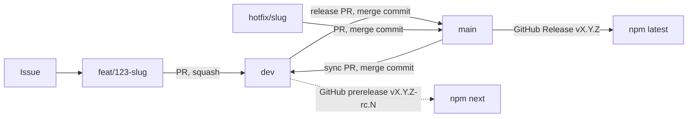

# Contributing to ds-dot

## Local development

Install dependencies, link your checkout into DeepSeek Harness, and run a watch build while developing:

```sh
pnpm install
dsh plugin --profile web add link:/path/to/ds-dot
pnpm watch
```

The linked checkout exposes `src`, and `pnpm watch` rebuilds `lib` as you edit. If pnpm asks for build permission when linking from source, allow `ds-dot` in that profile's `pnpm-workspace.yaml` and run `dsh plugin --profile web add link:/path/to/ds-dot` again.

Before pushing, run the same checks CI runs:

```sh
pnpm typecheck && pnpm test && pnpm build
```

## Branches and workflow

`dev` is the integration branch for ongoing work; `main` holds only published releases and hotfixes. Direct pushes to either branch are blocked by repository rulesets.



Feature and fix pull requests squash-merge into `dev` so the PR title becomes the single commit and release-notes line. Release (`dev` → `main`), hotfix (`hotfix/*` → `main`), and sync (`main` → `dev`) pull requests use merge commits so `main` and `dev` continue sharing history.

1. **Start from an issue.** Open or pick an issue and assign yourself so nobody duplicates the work (small typo or docs fixes can skip this).
2. **Branch from the latest `dev`** (using `feat/<issue>-<slug>`, `fix/<issue>-<slug>`, `refactor/...`, or `docs/...`):
   ```sh
   git switch dev && git pull
   git switch -c feat/123-short-name
   ```
   If `dev` moves on while you work, update with `git merge origin/dev` (or rebase and force-push your own branch only).
3. **Commit as you like** on your branch, then **open a pull request into `dev`**. GitHub preselects `main` (the default branch); change the base to `dev`.
   - Use a [Conventional Commits](https://www.conventionalcommits.org/) title (`feat(work): render English work orders`). Allowed types: `feat`, `fix`, `perf`, `refactor`, `docs`, `test`, `build`, `ci`, `chore`, `revert`, `release`. Add `!` for breaking changes (`feat(api)!: ...`).
   - Add `Closes #123` in the description so the issue closes when merged.
   - Keep PRs focused; prefer several small PRs to one large one.
   - If the pull request changes the interface, put a recorded GIF in the body. See [Frontend changes](#frontend-changes).
4. **Pass checks and review.** `CI result` (typecheck, test, build, and pack on Linux and Windows) and `PR title` must pass, and all review threads must be resolved before squash-merging into `dev`. A frontend change also needs the GIF from [Frontend changes](#frontend-changes) visible in the body. The checks do not look for that GIF.
5. **Squash and merge**, then delete the branch.

## Frontend changes

Every author follows this rule. Reviewers apply it to every pull request.

A pull request changes the frontend when it changes what a person sees or does in Dorothy's interface inside DeepSeek Harness. That includes the client components (`src/**/*.tsx`, other than `*.spec.tsx`), the words those screens show (`src/ui-copy.ts` and `locale/*.json`), and icons the interface uses (`icon.svg` and the icon components). Any other diff that changes that interface counts as well. Server behavior, tests, and documentation that leave the interface unchanged do not.

When the pull request does change the frontend, the body shows a GIF recorded in DeepSeek Harness from this pull request's code. The recording covers the interaction that changed and the result on screen, including the effect of a fix. Name the commit the recording shows. Embed the GIF in the body, or link an image URL that renders there, and leave the file off the branch. The recording shows the real interface. A still screenshot, a mockup, a generated animation of the UI, or a sentence that says a recording exists leaves the requirement unmet.

Record it with the `dsh-web-acceptance` skill in `.agents/skills/dsh-web-acceptance/`: the bundled script starts an isolated `dsh web` with its own `DSH_HOME`, exchanges the launch token for a cookie, and writes screenshots or a palette-optimized GIF outside the checkout.

Keep API keys, tokens, cookies, and personal data out of the recording.

A pull request that leaves the interface unchanged writes `No frontend changes` in the body. That sentence is for a diff that really leaves the interface alone, such as a backend-only, test-only, or docs-only change. A note that the change is small, internal, or unlikely to be noticed does not excuse a diff that changes the interface.

Nothing in CI checks that a GIF is present, or that a GIF is a real recording of the interface. Reviewers compare the body with the diff.

## Releases and hotfixes

See [docs/releasing.md](docs/releasing.md).
